



I am a B.Tech Computer Science student at Pragati University (2025 – 2029) who works across the data lifecycle: SQL and ETL pipelines, machine learning models, forensic security tooling and BI dashboards.

My projects report measured results: 1.2M+ transactions modelled, 86% churn-model recall, 40% less log review time. I am looking for internships and graduate roles in data engineering, AI engineering, security and cloud.




<table>
<tr>
<td><a href="https://github.com/25A31A05GA/bi-command-center">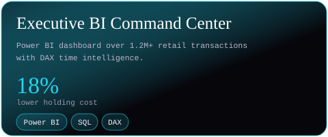</a></td>
<td><a href="https://github.com/25A31A05GA/churn-retention-platform">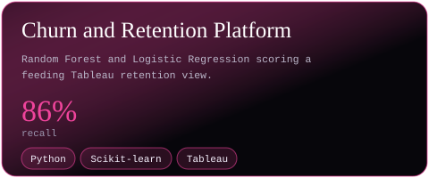</a></td>
</tr>
<tr>
<td><a href="https://github.com/25A31A05GA/tracexmail-verimedia">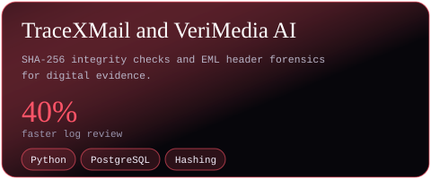</a></td>
<td><a href="https://github.com/25A31A05GA/fraud-ring-investigator">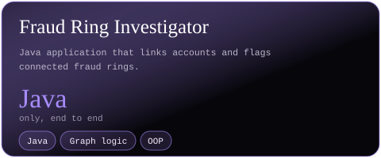</a></td>
</tr>
<tr>
<td><a href="https://github.com/25A31A05GA/owner-control-room">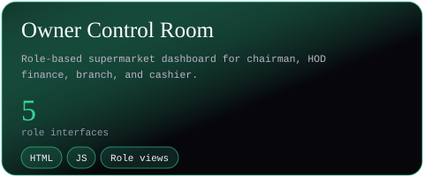</a></td>
<td><a href="https://github.com/25A31A05GA/portfolio">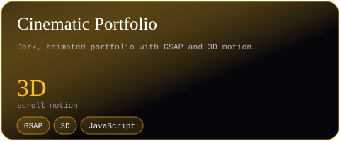</a></td>
</tr>
</table>



- Microsoft Certified: Power BI Data Analyst Associate (PL-300)
- Google Data Analytics Professional Certificate
- IBM Data Analyst Professional Certificate
- Advanced SQL and Relational Database Design (Udemy)
- 1st place, University Data Hackathon (real-time anomaly detection dashboard)


**Email** sairamsaladi3@gmail.com | **LinkedIn** [sai-ram-saladi](https://www.linkedin.com/in/sai-ram-saladi-899b56331)

